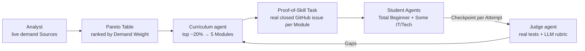

# ParetoAI

**Self-taught developers struggle to become job-ready. ParetoAI finds the 20% of skills that actually matter, builds a lean course from them, and then stress-tests that course with AI students fixing real GitHub bugs.**

Built for **#neatHack** with [neatlogs](https://neatlogs.com), [Entire](https://docs.entire.io) and [cfo.ai](https://cfo.ai).

**Demo video:** https://youtu.be/zwG3K0RKZSc

---

## The problem

A course on a new skill can have hundreds of topics. A beginner can't tell which ones matter for a job, and nobody checks whether the course actually works. ParetoAI answers both questions:

1. **What matters?** It ranks skills by real job-market demand and keeps only the top ~20% (the Pareto cut).
2. **Does it work?** It builds simulated learners that try to fix real bugs using *only* that course, and a Judge grades their fixes against the fix real developers merged.

The MVP targets one skill: **smart contract development (Solidity/EVM)**. Its proof-of-skill step needs real, gradable GitHub issues with merged fixes, and smart-contract repos have plenty.

## How it works



1. **Analyst** fetches live demand Sources (O\*NET 15-1299.07 task importance ratings, the OWASP Smart Contract Top 10, Cyfrin SSCD+ exam objectives) and produces a **Pareto Table** ranked by **Demand Weight**.
2. **Curriculum agent** cuts the top ~20%, pulls in hard prerequisites, and orders them into **Modules**, each with 1–2 best Resources.
3. **Proof-of-Skill sourcing** gives each Module a real closed GitHub issue (OpenZeppelin by default). The merged PR that closed it is the **Ground Truth**, kept in a separate type that Student Agents can never reach.
4. **Student Agents** are real coding-agent sessions (OpenCode): they clone the repo, edit files, run tests and commit. Their knowledge is bounded to the course through a local RAG retriever. One agent plays a *Total Beginner*, the other a learner with *Some IT/Tech Background*.
5. **Judge agent** grades each Attempt two ways: the repo's own test suite plus the Ground Truth's regression test, and an LLM rubric comparing the diff to the real fix. The rubric produces **Gaps**.
6. **Rounds:** Gaps feed back to the Curriculum agent, which patches the course (it may add up to 2 skills the first cut left out). The loop stops when **every** Learner Profile clears 70% on its own, or after **3 Rounds**. It ends in an honest **Readiness Report** that lists unresolved Gaps rather than presenting an unfinished course as job-ready.

The domain vocabulary (Source, Demand Weight, Module, Attempt, Gap, Round…) is defined in [`CONTEXT.md`](CONTEXT.md).

## How we used the partner tools

### neatlogs: tracing, debugging, improving
- Every agent runs inside one workflow, `pareto-ai`: a `WORKFLOW` span per Round, `AGENT` spans for the Analyst, Curriculum and Judge, and `RETRIEVER` + `EMBEDDING` spans for retrieval ([`pareto_ai/llm.py`](pareto_ai/llm.py), [`pareto_ai/retrieval.py`](pareto_ai/retrieval.py)).
- neatlogs raised incidents on two failure modes, and the pipeline now stops loudly on both. **All-zero embedding vectors** (a zero vector scores 0 against everything, so a half-failed embedder would look like "nothing in this Curriculum covers that"): retrieval now raises `RetrievalError`. **Missing Attempt grades** (a pass rate over zero graded Attempts would read as 100%): the Round now refuses with `RoundError`.
- Both follow [ADR-0002](docs/adr/0002-agents-refuse-invisible-llm-degradation.md): degrade quietly only where the degradation shows up in the output; refuse loudly where it would be invisible.

### Entire: checkpoints, repo map, an external agent
- **Checkpoints.** Each Attempt workspace is enabled with `entire enable --agent opencode --checkpoint-backend branch`, and capture is verified with `entire checkpoint explain <sha>` rather than assumed ([`student_agent.py`](pareto_ai/student_agent.py)). Verified example: Checkpoint `dc5cb4728b11` on commit `553813f`, 95.3k tokens, full transcript. The run hit its 5-minute deadline, but the commit and its transcript survived. Sanitized capture: [`docs/evidence/entire-checkpoint-2026-10-12.txt`](docs/evidence/entire-checkpoint-2026-10-12.txt).
- **entire-graph.** Each Attempt starts from `entire graph snapshot`. OpenZeppelin's raw snapshot is 4.5 MB, so it is rendered into a 2 KB, relevance-ranked Repo Map the agent can actually read.
- **External agent.** When Entire retired native Gemini CLI support, we built `entire-agent-gemini` on Entire's Agent Integration Protocol ([`pareto_ai/entire_agent_gemini.py`](pareto_ai/entire_agent_gemini.py), 37 tests). It worked, but Gemini CLI's own policy engine blocked headless shell use, so the Student Agent moved to OpenCode. The integration stays as documented evidence ([ADR-0004](docs/adr/0004-entire-gemini-support-retired-build-custom-integration.md), [ADR-0005](docs/adr/0005-opencode-replaces-gemini-cli-as-the-student-agent-engine.md)).

### cfo.ai: the business plan
Ari built a 24-month plan from [`docs/business-plan.md`](docs/business-plan.md): https://app.cfo.ai/s/0tswRgOA4z8tEgYk

| Question | Base case (Ari's output) |
| --- | --- |
| Cost to generate one curriculum | ~$2.41 (passes in Round 1), ~$4.44 typical, ~$9.48 (all 3 Rounds, 42 Attempts) |
| Minimum raise | $2,125 |
| Cash breakeven | March 2027 |
| B2B gross margin | 91.3% direct, 79.0% after the free-tier subsidy |
| Free tier | 1 curriculum per verified user per month |

**These are assumptions, not forecasts.** Sales, prices and Round odds are unvalidated estimates, no customer exists yet, and only the pipeline cost drivers are measured. The downside stress case needs about $600k and does not break even. See the plan for the full assumption list.

## Results so far

- The first real graded Attempt **failed**: `passed=False` with 5 Gaps. The Student Agent added a `_hasTokenURI()` helper where the real fix added `_suffixURI()`. That is the system working as intended: it exposed what the course did not teach.
- **289 tests pass** (1 expected failure), run on 2026-10-12.
- Measured fixes along the way (from local run logs): `hardhat test` in a copied workspace went from 140–160 s to 25 s; OpenCode start-up with Entire went from stalled past 150 s to 107 s; runs ending in an agent's own commit went from 0 of 6 to 1.
- **Not yet run live:** the full multi-Round loop (`python -m pareto_ai.rounds`). It is built and unit-tested with fakes, but a full run is hours of real agent sessions against a shared budget.

The full dated build log, including every failure and fix, is in [`hackathon.md`](hackathon.md).

## Run it yourself

**Requirements:** Python 3.11, Node.js, git, an authenticated [`gh`](https://cli.github.com) CLI, the [Entire CLI](https://docs.entire.io) (logged in with `entire login`, with the graph plugin via `entire plugin install graph`), and OpenCode pinned to `1.18.35` (`npm install -g opencode-ai@1.18.35`; newer versions reject Entire's generated plugin).

```bash
python -m venv venv
# Windows: venv\Scripts\activate    macOS/Linux: source venv/bin/activate
pip install neatlogs python-dotenv openai requests beautifulsoup4 pytest
pip install torch --index-url https://download.pytorch.org/whl/cpu --timeout 120 --retries 10
pip install sentence-transformers          # local embeddings for retrieval
```

Create a `.env` (gitignored):

```
LITELLM_API_KEY=...    # neatHack's LiteLLM gateway; every agent uses it
NEATLOGS_API_KEY=...
```

Then run any stage, each building on the one before:

```bash
python -m pareto_ai.analyst          # live Pareto Table ranked by Demand Weight
python -m pareto_ai.curriculum       # Analyst → ordered Curriculum of Modules
python -m pareto_ai.proof_of_skill   # …plus a real closed GitHub issue per Module
python -m pareto_ai.retrieval        # query the Curriculum like a Student Agent would
python -m pareto_ai.judge            # one real Attempt, graded (about 9 min first run, then ~8–10 min)
python -m pareto_ai.rounds           # the full loop (hours; real gateway spend)
python -m pytest                     # 289 tests
```

Notes: the first `judge` run builds a one-off warm base of the target repo (about 9 minutes). Every LLM call spends the hackathon's shared LiteLLM budget ($20 per 30 days, shared across the team). The warm-base and process machinery is Windows-specific (junctions, Job Objects, `taskkill`) and has not been exercised elsewhere.

## Repository map

| Path | What it is |
| --- | --- |
| [`pareto_ai/analyst.py`](pareto_ai/analyst.py) | Live Sources → Pareto Table |
| [`pareto_ai/curriculum.py`](pareto_ai/curriculum.py) | Pareto cut, prerequisite closure, Modules |
| [`pareto_ai/proof_of_skill.py`](pareto_ai/proof_of_skill.py) | Real closed issues; Ground Truth kept separate |
| [`pareto_ai/retrieval.py`](pareto_ai/retrieval.py) | RAG that bounds students to the course |
| [`pareto_ai/student_agent.py`](pareto_ai/student_agent.py) | OpenCode Attempts, Entire enablement, Repo Map |
| [`pareto_ai/judge.py`](pareto_ai/judge.py) | Test-suite + LLM-rubric grading, Gaps |
| [`pareto_ai/rounds.py`](pareto_ai/rounds.py) | Round loop, per-profile gating, Readiness Report |
| [`pareto_ai/warm_base.py`](pareto_ai/warm_base.py), [`frozen.py`](pareto_ai/frozen.py), [`processes.py`](pareto_ai/processes.py) | Fast, repeatable, isolated Attempts |
| [`pareto_ai/entire_agent_gemini.py`](pareto_ai/entire_agent_gemini.py) | Entire External Agent for Gemini CLI |
| [`docs/adr/`](docs/adr) | Nine decision records, including the corrections we made to our own earlier decisions |
| [`docs/research/`](docs/research) | Primary-source research behind the choice of demand Sources |

## Known limitations

- **O\*NET's demand weights are coarse.** Only about 4 of its 17 tasks are Solidity-level work, so Demand Weights fall into about 4 tiers and OWASP's order breaks ties within a tier ([ADR-0007](docs/adr/0007-skills-take-demand-through-occupational-tasks-and-a-rank-orders-without-weighing.md)).
- **A Curriculum holds pointers, not prose:** a topic, what it assumes, and 1–2 links. Whether that is enough to succeed is exactly what the Attempts measure.
- **Retrieval cannot say "nothing here covers that"**: it returns its k nearest Modules, so an off-topic question still gets answers.
- **The Ground Truth is closed off in the repository and tools, not on the machine.** A shell can still reach github.com, so read a pass rate with that in mind ([ADR-0008](docs/adr/0008-an-attempt-cannot-reach-its-own-fix-through-its-repository-or-the-web.md)).
- **The pinned task is close to unwinnable by design:** its regression test calls `_suffixURI`, a name the issue never gives. It is a fair grade but a poor demonstration. A task whose test follows from its issue text would show the course working or failing on its merits.
- **A full Attempt cycle takes 8–10 minutes**, not the 5 we aimed for.
- **One Windows process-kill case is unsolved** (`xfail` in `tests/test_processes.py`).

## Credits and licensing

- Occupational data from [O\*NET](https://www.onetonline.org) 15-1299.07 Blockchain Engineers, by the U.S. Department of Labor, Employment and Training Administration, licensed [CC BY 4.0](https://creativecommons.org/licenses/by/4.0/).
- Proof-of-Skill Tasks come from [OpenZeppelin Contracts](https://github.com/OpenZeppelin/openzeppelin-contracts) (MIT).
- Built by [@Captin_Div](https://x.com/Captin_Div) during neatHack, October 10–12, 2026, with [@neatlogs](https://x.com/neatlogs), [@EntireHQ](https://x.com/EntireHQ) and [@arithecfo](https://x.com/arithecfo).
- Licensed under the [MIT License](LICENSE). The O\*NET data and OpenZeppelin code noted above keep their own licenses.
